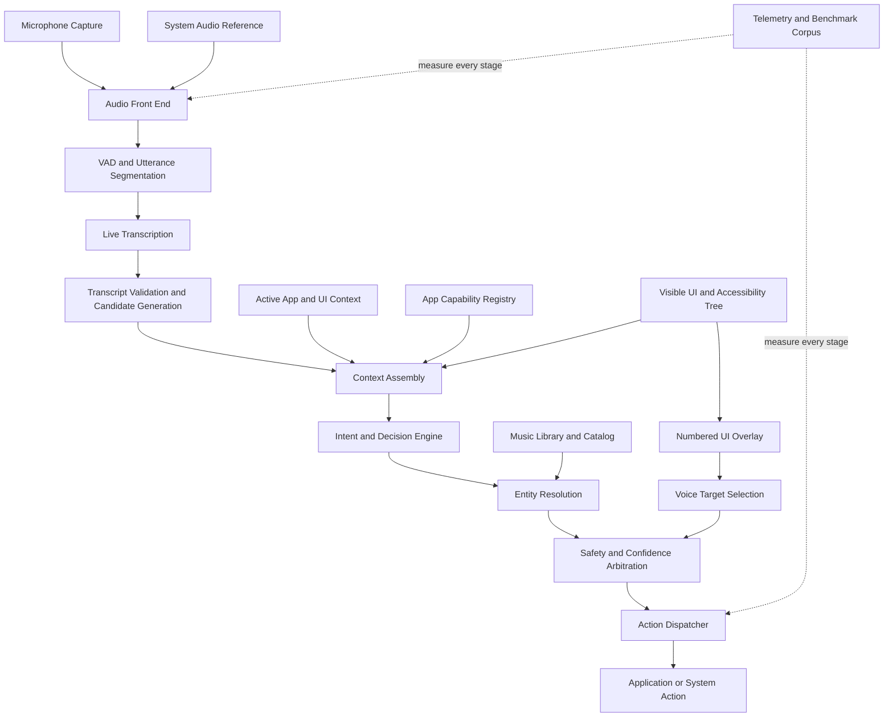

# Reflex Architecture Roadmap
## From the current engine to a context-aware voice interaction system

**Starting point:** Current v0.4/v0.4b work and the November 3 session findings
**Target:** A reliable, context-aware, low-latency voice-control engine for macOS, with a reusable foundation for iOS/iPadOS
**Guiding principle:** Correct execution first, then optimize latency without weakening safety or confidence thresholds.

---

## 1. Target architecture

Reflex should evolve toward the following logical pipeline:



This is the intended destination, not a claim that all these components already exist. The implementation should preserve working parts of the current engine and introduce these capabilities incrementally.

### Architectural boundaries

- **Audio front end:** improves the signal reaching the recognizer. It does not interpret commands.
- **Transcription:** determines what was spoken, preserving uncertainty and alternatives where possible.
- **Context assembly:** supplies the active app, UI state, supported capabilities, and relevant recent interaction.
- **Decision engine:** determines the user's intent and whether there is enough evidence to act.
- **Entity resolution:** resolves names such as "Weekend" to a specific artist or track.
- **Action dispatcher:** executes a validated action once, with appropriate error handling.
- **UI targeting:** identifies visible interface elements and provides reliable spoken references to them.
- **Telemetry:** measures accuracy, latency, failures, false activations, and duplicate actions across the entire pipeline.

These boundaries are important: better context should not conceal transcription problems, and faster dispatch should not conceal incorrect intent decisions.

---

## 2. Phase 0 — Establish a trustworthy baseline

**Priority: P0 | Prerequisite for all major changes**

Before changing the engine, establish what the current implementation actually does and where its failures originate.

### Work

1. Audit the existing implementation of `MicMonitor`, `LiveTranscriber`, `TranscriptSanitizer`, `RuleRouter`, `LayaRouter`, `DecisionArbiter`, `PayloadExtractor`, `ActionDispatcher`, and `NowPlaying`.
2. Map the actual runtime call graph, including early commits, finalized segments, queue handling, cancellation, and duplicate prevention.
3. Verify that early and finalized execution cannot dispatch the same utterance twice.
4. Identify where app context, selected UI elements, and entity information can enter the existing pipeline.
5. Define one canonical event schema with monotonic timestamps and an utterance/action correlation ID.
6. Build a manually labelled corpus from real sessions, with expected outcomes and error categories.
7. Separate local commands from commands requiring external services, such as web searches and music catalog lookups.

### Required measurements

- Correct execution rate on eligible commands.
- False activations and incorrect actions.
- False rejections and missed commands.
- Duplicate execution rate.
- Last-voiced-frame-to-action-completion latency: mean, median, p95.
- Per-stage latency for VAD tail, transcription, routing, arbitration, entity resolution, and dispatch.
- Results split by command type, active app, playback state, and execution path.

**Current reference point:** the latest session showed approximately 1,044 ms mean, 1,038 ms median, and 1,698 ms p95 for the reported voice-to-dispatch measurements. These are baseline observations, not a fully labelled accuracy benchmark.

### Exit gate

- A repeatable benchmark can reproduce the current measurements.
- Each evaluated command has a manually verified expected outcome.
- The team can identify whether a failure originates in capture, transcription, interpretation, resolution, or execution.
- Existing functionality has regression tests before architectural changes begin.

---

## 3. Phase 1 — Build the shared context and capability foundation

**Priority: P0 | The foundation for app-aware behavior**

Do this before building individual app-specific command collections.

### 3.1 Active application context

Introduce an `AppContextProvider` that reports, where available:

- Frontmost application identity and bundle ID.
- Window and document context.
- Current UI element, selection, and focused control.
- Available accessibility information.
- Context freshness and confidence.
- Whether the app or its UI state changed during the utterance.

Do not assume that the foreground app's identity tells Reflex everything about its current state. Context must be refreshed when it can change the meaning of a command.

### 3.2 App capability registry

Create a declarative registry describing what Reflex knows how to do in each supported application.

Conceptually:

```text
ApplicationCapability
  appIdentifier
  supportedActions
  actionAliases
  requiredContext
  parameterSchema
  executionAdapter
  confidenceRequirements
  confirmationPolicy
  fallbackBehavior
  capabilityVersion
```

Keep this separate from both the transcription model and the global intent classifier.

The registry should describe semantic actions rather than requiring users to know keyboard shortcuts. Shortcuts may be used internally as an execution mechanism when appropriate, but they should not define the voice interface.

### 3.3 Context-aware candidate generation

Change the decision engine to consider:

- The spoken phrase.
- Global command capabilities.
- The active application's supported actions.
- Current UI state and selection.
- Relevant conversation or action history.
- Confidence and ambiguity.

The active app should influence interpretation without forcing every utterance to be an app-specific command. Global commands such as "open Safari" must continue to work regardless of which app is active.

### Exit gate

- Context is observable and logged.
- App-specific capabilities can be added without modifying the core audio pipeline.
- Unsupported actions fail safely.
- Global commands continue to work across applications.
- Context switching does not leak stale targets or parameters into the next command.

---

## 4. Phase 2 — Introduce semantic app actions, starting with Calculator

**Priority: P0 | First complete app-aware implementation**

Calculator is the first vertical slice for the app-capability architecture.

The goal is not to teach users to say "Press C." The goal is for Reflex to understand the operation they intend and perform the appropriate action in the current context.

### Calculator capabilities

Build and validate semantic actions such as:

- Clear the current entry.
- Clear the entire calculation.
- Correct or replace the last input when supported.
- Enter numbers and operators.
- Evaluate an expression.
- Read or explain the current result when the UI exposes it reliably.
- Recover safely from unsupported or ambiguous operations.

The exact vocabulary and available actions should be grounded in Calculator's real behavior and the accessibility or UI state that macOS exposes.

### Example behavior

| User says | Reflex should do |
|---|---|
| "Clear this entry" | Clear the current entry, if the current state supports that operation |
| "Clear everything" | Perform the appropriate full-clear operation |
| "What is the result?" | Read the result if it can be obtained reliably |
| "Multiply that by five" | Use the current result only when its value and context are known |
| "Undo that" | Undo only if the application supports a reliable, appropriate undo action |

"Clear it" may be ambiguous. Reflex should use available state to resolve it or ask a concise clarification rather than guessing.

### Implementation approach

1. Implement a `CalculatorCapabilityProvider`.
2. Add a `CalculatorActionAdapter` for execution.
3. Represent actions with typed parameters rather than free-form strings.
4. Use UI state to resolve distinctions such as entry-clear versus full-clear.
5. Add tests for alternate phrasings, ambiguous requests, application changes, and failed execution.
6. Verify the result of actions when the UI provides a reliable verification path.

Avoid creating a new Laya action kind for every app-specific verb if the existing routing layer can represent the operation as a typed semantic action. If a model-schema change is genuinely required, follow the existing checkpoint and compatibility process.

### Exit gate

Calculator can be operated naturally using semantic commands, without users memorizing keyboard shortcuts. Ambiguous commands do not produce destructive or unintended operations.

---

## 5. Phase 3 — Music entity resolution (and note/mail creation)

**Priority: P0 | Required product capability**

Treat this as a separate capability from generic play/pause/next/previous media control.

The current architecture can recognize a generic media command, but a request such as "Play Weekend" requires understanding *what* should play.

### Target pipeline

```text
"Play Weekend"
      |
      v
Music intent detection
      |
      v
Extract artist / album / track / playlist
      |
      v
Search available authorized sources
      |
      v
Normalize names and generate candidates
      |
      v
Rank candidates using linguistic and contextual evidence
      |
      v
Confidence and ambiguity check
      |
      +---- High confidence ----> Play resolved entity
      |
      +---- Ambiguous ----------> Ask a short clarification
      |
      +---- No match -----------> Report no reliable match
```

### Implementation

1. Add a typed `MusicIntent` with entity type, query, playback operation, and confidence.
2. Add a `MusicEntityResolver` that returns ranked candidates and their source.
3. Support spelling normalization, phonetic similarity, aliases, and common misrecognitions.
4. Prefer authorized local-library or account data when available, with catalog search as a separate capability.
5. Add a provider abstraction so the resolver does not depend on one specific music service.
6. Connect the resolved entity to a playback adapter.
7. Track whether the requested entity was actually played, rather than treating a successful media-key event as proof.
8. Ask for clarification when several plausible candidates exist.

### Note and mail creation (same phase)

"Create a new note" and "create a new mail" belong here alongside music entity resolution: each is a **creation action that must resolve a target container** (note folder/account, mail mailbox/account) before creating the item, then verify the result.

- **Create a new note:** resolve the target account/folder (default or named), create the note with the spoken title/body, verify it exists in that container.
- **Create a new mail:** resolve the target mailbox/account and recipient(s), compose the message, verify it was saved/sent to the intended mailbox.
- Reuse the same entity-resolution + confirmation + verification discipline as music: rank candidates, ask on ambiguity, report on no match, never guess.

### Important constraints

- Determine which music sources are available and authorized before implementing a provider.
- Do not assume that Apple Music, the Music app library, or another service exposes every desired search operation.
- Catalog search may require network access. Keep this distinct from local inference.
- Keep generic media controls working even when entity search is unavailable.
- Prefer a dedicated resolution stage over expanding a generic media rule into an unmaintainable collection of special cases.

### Exit gate

A labelled artist/track test set measures correct resolution, ambiguity handling, no-match behavior, and successful playback. "Play Weekend" should resolve to The Weeknd when the available evidence makes that the clear intended artist, without blindly accepting every phonetic resemblance. The same gate applies to note/mail creation: correct container resolution, successful creation, and verification (or a safe failure + clarification) on ambiguity.

---

## 6. Phase 4 — Build app capability packs for other supported apps

**Priority: P1 | Expand after the shared architecture and Calculator are proven**

Use the same registry and adapter interfaces for each additional app.

Prioritize apps according to actual use, accessibility support, and the frequency of commands in the benchmark rather than attempting to support every app simultaneously.

Potential capability packs include:

- **Browser:** navigate, search, select tabs, move between pages, interact with visible controls.
- **Finder:** navigate folders, open files, select items, and perform safe file operations.
- **Text editors:** select text, replace text, move the cursor, format content, and undo.
- **Terminal:** enter commands only through an explicit, carefully guarded workflow; do not execute arbitrary inferred commands without appropriate safeguards.
- **Media apps:** play, pause, search, select entities, and control playback.
- **System controls:** volume, brightness, windows, and other supported system actions.

Each capability pack should define:

1. Natural-language aliases.
2. Required UI or document context.
3. Typed inputs and validation.
4. Execution and result verification.
5. Confidence and confirmation rules.
6. Tests covering successful, ambiguous, unsupported, and failure cases.

### Important design rule

Do not let app-specific capabilities silently override global commands. Use a shared intent arbitration process that accounts for active context, command evidence, and the consequences of acting.

### Exit gate

A new supported app can be added through a capability pack and adapter, without duplicating transcription, decision arbitration, or telemetry infrastructure.

---

## 7. Phase 5 — Numbered UI overlay for visual browsing and control

**Priority: P1 | Can begin once context interfaces stabilize**

The numbering overlay should become a general interaction mechanism, not a one-off browser feature.

A user should be able to say "show numbers," then "click 12," without having to describe a button or memorize a coordinate.

### Target behavior

1. Detect the active window and its visible, actionable elements.
2. Obtain candidates from the macOS accessibility tree when possible.
3. Fall back to visual detection where accessibility information is incomplete.
4. Assign stable, temporary numeric labels to eligible targets.
5. Display the labels in an overlay aligned to the visible UI.
6. Accept commands such as "click 12," "open 4," "select 8," or "show numbers."
7. Resolve the spoken number against the current overlay session.
8. Validate the target before acting.
9. Dismiss or refresh the overlay when the window, layout, scroll position, or UI state changes.

### Suggested component boundaries

- `UIElementProvider`: collects actionable elements.
- `UITargetResolver`: ranks and identifies targets.
- `NumberedOverlayController`: owns overlay state and lifecycle.
- `OverlayRenderer`: draws labels over the relevant window.
- `UITargetActionAdapter`: performs and verifies the selected action.

### Reliability and safety

- Numbers should be assigned per current view and expire when that view changes.
- Do not act on stale labels.
- Prefer accessibility-backed actions to raw coordinate clicks.
- If a visual fallback is used, validate the target immediately before dispatch.
- Treat destructive actions differently from harmless navigation.
- Keep overlay visibility, numbering, and selection state in telemetry.

### Exit gate

The overlay works across a representative set of supported applications, correctly refreshes after UI changes, and does not click a stale or incorrectly resolved target.

---

## 8. Phase 6 — Audio front end and robust transcription

**Priority: P1 | Begin feasibility work during Phase 0; implement against measured evidence**

The existing `TranscriptSanitizer` validates transcript output. It is not an audio-cleaning system, and it does not fix accent-related recognition errors.

Reflex needs a separate audio-quality workstream.

### Work

1. Investigate macOS Core Audio Process Taps and the available ways to capture a synchronized playback reference.
2. Establish whether the current capture architecture can obtain both microphone audio and the relevant system output for the supported OS versions.
3. Prototype acoustic echo cancellation (AEC) and noise suppression (NS), potentially using a WebRTC Audio Processing Module bridge where appropriate.
4. Measure performance with clean speech, music playback, speech over music, background noise, and silence.
5. Retain raw-audio or reference recordings only under an explicit, privacy-conscious test policy.
6. Measure how preprocessing changes both command recognition and false activations.
7. Improve segmentation and streaming transcription independently from semantic routing.
8. Evaluate transcript alternatives or conservative correction for recurring recognition errors, without rewriting uncertain speech into a confident but incorrect command.

### Keep these concerns distinct

- AEC reduces echo from playback.
- NS reduces background noise.
- VAD identifies speech activity.
- Transcription estimates spoken words.
- Transcript validation rejects unsuitable output.
- Semantic interpretation infers intent.

None of these is a substitute for the others. Speaker verification remains a separate, later decision unless testing establishes a clear need.

### Exit gate

Preprocessing demonstrates a repeatable improvement in relevant noisy/playback scenarios without unacceptable degradation of clean-speech accuracy, latency, or false-activation rates.

---

## 9. Phase 7 — Live decisions, latency, and execution reliability

**Priority: P1 | Optimize after measurement and the major context interfaces are in place**

Keep the existing rule-first path and incremental decision mechanism where they are beneficial, but validate them against the labelled corpus.

### Work

- Profile VAD tail, live decoding, final decoding, routing, arbitration, entity resolution, queue waiting, and dispatch separately.
- Reduce unnecessary work between stable intent detection and dispatch.
- Reuse validated transcript and intent results rather than recomputing them.
- Avoid blocking the segment queue on slow media-state queries or external lookups.
- Make cancellation and context invalidation explicit.
- Preserve a single execution owner per utterance.
- Continue excluding text-entry actions from early commit unless a separately validated mechanism proves them safe.
- Use asynchronous resolution where possible, while preventing stale results from dispatching into a changed context.
- Separate local action timings from external service timings.

### Latency targets

| Metric | First goal | Longer-term goal |
|---|---:|---:|
| Mean last-voiced-to-action-completion latency | Under 1,000 ms | 500–750 ms |
| End-to-end success on eligible labelled commands | At least 85% | 90%+ |
| Duplicate unintended executions | Near zero | Near zero |
| False activations and unsafe actions | Near zero | Near zero |

These are product targets, not claims about current performance. Measure them by command category and report p50/p95 as well as the mean.

Do not hit a latency target by weakening confidence thresholds, committing ambiguous commands, skipping needed entity resolution, or allowing duplicate execution.

---

## 10. Phase 8 — Unified regression, release, and platform readiness

**Priority: P1/P2 | Continuous across all phases**

Every new capability must join the same test and release discipline.

### Regression suite

Include:

- Clean speech with no media playing.
- Speech over music and system playback.
- Background media without a spoken command.
- Turkish-accented English and other observed transcription edge cases.
- Global commands while different applications are active.
- App-specific commands in the correct and incorrect context.
- Ambiguous commands and missing entities.
- Music artist, album, and track resolution.
- Numbered overlay targeting and stale-target invalidation.
- Early commit versus finalized execution.
- Queue backlog, slow providers, cancellation, and app switching.
- Dispatch failures and action-result verification.

### Release requirements

- No regression in previously supported core commands.
- Benchmark results and labelled failure analysis attached to the release evidence.
- Changes to action schemas and model checkpoints are versioned and tested together.
- External-service dependencies and permissions are documented.
- macOS-specific capabilities are isolated from shared logic so iOS/iPadOS can reuse the appropriate parts without inheriting unsupported macOS assumptions.

---

## 11. Recommended implementation order

| Order | Milestone | Main deliverable |
|---|---|---|
| 1 | Phase 0 | Reproducible baseline and labelled corpus |
| 2 | Phase 1 | Shared app context and capability registry |
| 3 | Phase 2 | Natural-language Calculator capability pack |
| 4 | Phase 3 | Music entity resolution and playback verification (plus note/mail creation) |
| 5 | Phase 4 | Additional app capability packs |
| 6 | Phase 5 | Numbered UI overlay |
| 7 | Phase 6 | Measured audio preprocessing and transcription improvements |
| 8 | Phase 7 | End-to-end latency and reliability optimization |
| 9 | Phase 8 | Release gates and cross-platform readiness |

Audio feasibility research should begin in Phase 0 rather than wait until Phase 6. Likewise, the overlay's accessibility and target-resolution interfaces can be prototyped while the capability registry is being designed. The sequence above is the order for production integration, not a ban on parallel investigation.

---

## 12. Branch and integration discipline

Keep each milestone isolated in a feature-focused `atlas/*` branch created from the latest `dev`, consistent with the existing workflow.

Suggested branch names:

- `atlas/context-capability-foundation`
- `atlas/calculator-capabilities`
- `atlas/music-entity-resolution`
- `atlas/app-capability-packs`
- `atlas/numbered-ui-overlay`
- `atlas/audio-front-end`
- `atlas/latency-reliability`

For each branch:

1. Audit the relevant existing implementation before editing.
2. Define interfaces and acceptance tests first.
3. Implement the smallest complete vertical slice.
4. Run the relevant regression and benchmark suites.
5. Document changed behavior, limitations, and evidence.
6. Integrate through `dev` only after the branch passes its gates.

Avoid running every workstream as a simultaneous rewrite. In particular, the context registry should be stable before app packs proliferate, and music resolution should have a clear interface before it becomes entangled with generic media-control routing.

---

## Definition of success

Reflex succeeds when users can speak naturally, with the current application and visible context doing useful work behind the scenes. They should not have to memorize shortcut letters, exact application-specific command syntax, or the internal structure of the engine.

A command should be interpreted with enough context to understand what it refers to, resolved to the correct target, executed once, and verified where possible. If the system cannot safely determine the intent or target, it should ask rather than guess.

The goal is not a bigger list of voice commands. It is a **shared, context-aware interaction engine with reusable app capabilities, reliable entity resolution, and direct voice access to visible UI elements**.
